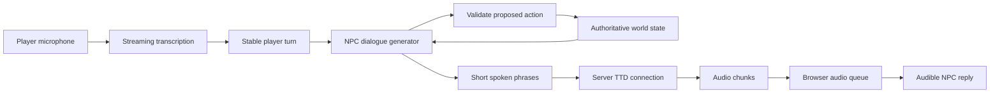

# Realtime NPC architecture

This document proposes an Expatia World implementation. Timing targets, message names, and ownership rules are application design choices. Provider behavior is linked separately.

## From player speech to an NPC reply



The browser owns microphone capture and audible playback. The server owns credentials, character identity, dialogue requests, synthesis connections, and game action validation. The game provides only the world facts that the character is allowed to know.

A staged prototype is easier to diagnose: first send typed dialogue through Turbo, then add push to talk transcription, then add automatic turn detection and interruptions. Keep separate measurements for each stage.

## Transcription and turn detection

Scribe v2 Realtime is an available ElevenLabs streaming transcription option. It accepts a microphone stream and emits partial and committed transcripts. Partial text can change; commit a stable player turn before applying an action. Manual commit and VAD commit are separate strategies. [Transcript and commit guide](https://elevenlabs.io/docs/eleven-api/guides/how-to/speech-to-text/realtime/transcripts-and-commit-strategies), [Browser transcription guide](https://elevenlabs.io/docs/eleven-api/guides/how-to/speech-to-text/realtime/client-side-streaming).

The reviewed commit guide also describes buffering approximately the first two seconds of audio at session start. Therefore the advertised roughly 150 ms transcription latency should not be assumed for a newly connected, one-word interaction. Benchmark short utterances, startup, and retained sessions separately. A provider's partial transcript latency is different from the time required to decide that a turn is complete.

For the first demo, push to talk makes the player's endpoint explicit. Send microphone audio while the button is held, commit on release, and stop capture if the user leaves the conversation. For automatic turn detection, evaluate a silence window against actual player speech; a 250–400 ms application window is only a proposed local starting range, not a claim about allowed Scribe parameters. Avoid cutting off a player thinking between clauses.

Browser capture should account for echo cancellation, noise suppression, device sample rate, and headphones versus speakers. Test whether NPC playback is transcribed back into the microphone. A silent-room laptop test alone does not validate an exhibition floor.

## Generate the first useful phrase early

Use a streaming dialogue generator. It can be a directly connected language model or a routed text model. Request a short answer grounded in the current game state. The first phrase should contain useful content, such as `The key is with the dock keeper.` A generic filler phrase may reduce a timer while making the interaction feel slower.

Convert token output into phrases before sending it to synthesis. An original phrase buffer can:

1. Hold incomplete bracket tags and incomplete words.
2. Emit a natural clause when punctuation arrives.
3. Emit a sufficiently complete phrase after a bounded wait if punctuation is delayed.
4. Preserve spaces between sends.
5. Flush the final remainder when the dialogue stream finishes.

Tune the phrase wait against audible quality. Sending tiny fragments can damage prosody and still wait for provider buffering; collecting the whole answer adds delay. The TTD guide documents buffering and an explicit flush control. [Realtime TTD guide](https://elevenlabs.io/docs/eleven-api/guides/how-to/websockets/realtime-tdd).

Do not send streamed JSON syntax, character metadata, inventory objects, or proposed action descriptions to the voice model. Extract only approved spoken content. If the LLM must return structured output, either use an incremental parser that can safely expose the speech field or choose a transport that separates text and action events.

## Browser playback

For `pcm_24000`, decode base64 to bytes, preserve any incomplete 16-bit sample between chunks, convert signed little-endian integers to float samples, and schedule AudioBuffers at the correct source sample rate. The included [PCM player](examples/pcm-player.mjs) demonstrates this ownership and scheduling pattern.

Use one playback clock. Schedule a new buffer after the previous one; do not start every chunk immediately and create overlapping speech. A small scheduling cushion absorbs ordinary event-loop variation, while an unnecessarily large queue makes interruption feel delayed. Resume the browser AudioContext during a user gesture because playback may otherwise be suspended.

A production player should add queue duration limits, underrun metrics, gain control, device handling, and an AudioWorklet when sustained low-latency playback warrants it. The example is an integration helper, not a complete microphone or streaming application.

Use cached PCM or an approved prerecorded cue for a fallback only when it is appropriate to the current state. Do not play a cached answer to a different question just to hide a provider failure.

## Interruption and stale results

When the player starts a new turn while an NPC is speaking:

1. Increment the application's generation ID.
2. Stop all scheduled buffers and clear the playback queue.
3. Abort the current dialogue generation.
4. Stop forwarding text to the old synthesis generation.
5. Drop all late text, audio, and completion events belonging to the old generation.
6. Process the new player turn using the current authoritative game state.

A proposed local playback-stop target is 20 ms; it is an application target rather than a service guarantee. Measure from interruption detection to last audible sample.

The single TTD socket does not return the application's custom generation ID. A server must attach that identity to relayed audio. For a simple prototype, a dedicated socket per utterance makes ownership clear, at the cost of reconnect delay. For a retained socket, serialize turns, wait for the appropriate turn boundary, and implement a reliable mapping of server events to the owning application generation. If that mapping becomes ambiguous after cancellation, discard the connection and reconnect.

Capture the old socket identity in cleanup callbacks. A late close event from the old generation must never clear the new active socket. Sending `close_socket:true` requests a closing flush; it does not promise cancellation of synthesis. Local audio disposal is what prevents old speech being heard.

Game actions require their own ownership rules. An interrupted utterance does not automatically undo an already committed quest change. Validate each action once, give it an idempotency key, and define whether it commits before speech, after speech, or after player confirmation according to the gameplay design.

## Application relay protocol

These messages are proposed application envelopes; they are not ElevenLabs frames:

```json
{"type":"npc.audio","conversation_id":"c1","turn_id":12,"npc_id":"harbor_guide","format":"pcm_24000","audio":"BASE64_BYTES"}
```

```json
{"type":"npc.audio_end","conversation_id":"c1","turn_id":12}
```

```json
{"type":"npc.cancel","conversation_id":"c1","turn_id":12}
```

The browser accepts audio only for its current conversation and turn. The server selects voice IDs from its trusted manifest, not arbitrary client input. Rate-limit conversation creation and synthesized text length so that an exposed game client cannot freely consume the account quota.

## Connection ownership and scaling

Turbo's single registered voice means a persistent socket belongs to a voice identity. Do not allocate a socket for every NPC in the world for every player. Retain only active conversation resources and close them when the player leaves or the idle policy expires. A heartbeat prevents provider inactivity closure but also keeps a session slot reserved.

When multiple players speak to the same character, keep their dialogue context and audio routing isolated. A shared synthesis connection cannot safely interleave arbitrary turns merely because the voice is the same. Pooling needs exclusive leases or a queue, with explicit fairness and a maximum wait.

Run the relay near the players and measure the route to the provider. The EU residency hostname is for eligible isolated regional accounts, not a universal performance shortcut. [Data residency](https://elevenlabs.io/docs/overview/administration/data-residency).

## Speech Engine alternative

ElevenLabs Speech Engine combines speech input, output, and turn handling while allowing the application to supply its own LLM. Its SDK supports streamed responses and cancellation signals for interruptions. This can reduce orchestration work. [Speech Engine overview](https://elevenlabs.io/docs/overview/capabilities/speech-engine), [Integration cookbook](https://elevenlabs.io/docs/eleven-api/guides/cookbooks/speech-engine).

The reviewed quickstart does not establish the exact v4 Turbo selection and settings needed by this project. Confirm those capabilities before replacing the explicit TTD integration. Also check what conversation history is forwarded to the application and how game tools are validated. Keep a separate comparison of direct TTD orchestration versus Speech Engine based on measured onset, interruption, control, and cost.

## Suggested implementation sequence

1. Run a one-shot example with an available voice and listen to the complete output.
2. Feed a typed short reply into the browser PCM queue through the relay.
3. Add a turn ID and demonstrate that stale audio is discarded.
4. Add push to talk and committed transcription.
5. Add the NPC dialogue generator with short streamed phrases.
6. Connect authoritative world state and validated actions.
7. Add automatic endpointing, interruption, connection pooling, and telemetry.
8. Run the benchmark and character auditions before increasing scope.
